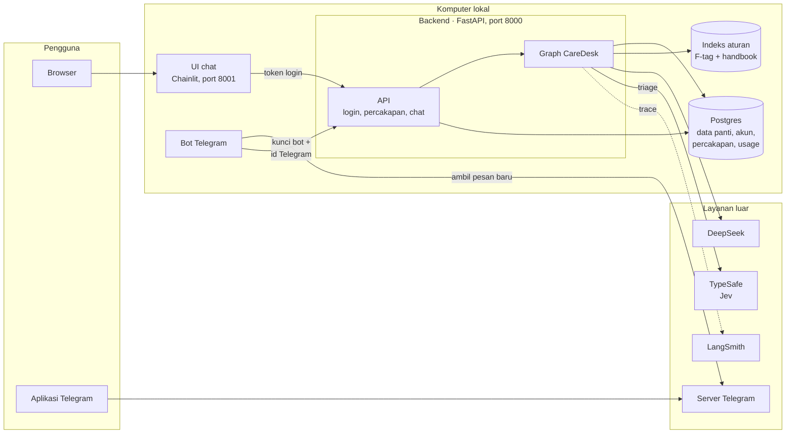
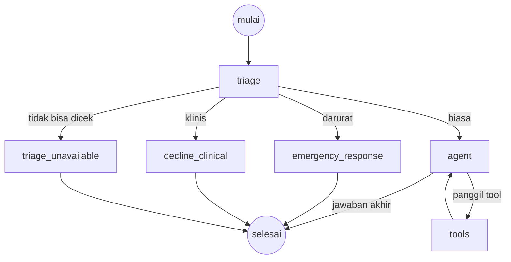

# CareDesk — Arsitektur

| | |
|---|---|
| Status | Draft |
| Rilis | 2 (backend dan UI chat) |
| Terakhir diubah | 2026-10-15 |

Dokumen ini menjelaskan cara CareDesk dibangun. Apa yang dibangun ada di [prd.md](prd.md), alasan tiap keputusan ada di [adr/](adr/).

> Ini terjemahan dari [architecture.md](architecture.md). Kalau isinya berbeda, yang berlaku adalah versi bahasa Inggris.

## 1. Gambaran umum

Semua bagian aplikasi jalan di komputer lokal. Yang di luar ada empat: DeepSeek (model), TypeSafe (Jev, untuk triage), server Telegram, dan LangSmith (tracing).

Ada dua pintu masuk: UI chat Chainlit di browser dan bot Telegram. Keduanya hanya klien, jadi tidak menyimpan logika atau data sendiri dan cuma memanggil backend ([ADR-0024](adr/0024-chainlit-ui-as-backend-client.md), [ADR-0027](adr/0027-telegram-as-a-backend-client.md)). Backend (FastAPI) mengecek siapa penggunanya, lalu menjalankan graph CareDesk di dalam prosesnya sendiri ([ADR-0020](adr/0020-own-backend-not-agent-server.md)). Semua data ada di satu database Postgres di Docker ([ADR-0021](adr/0021-one-postgres-database.md)).

Cara membacanya:

1. Pengguna chat lewat browser (Chainlit) atau Telegram. Bot mengambil pesan dari server Telegram sendiri, jadi tidak perlu alamat publik.
2. Klien meneruskan pesan ke API backend, bersama bukti identitas: token login dari Chainlit, atau kunci bot plus id Telegram pengirim dari bot.
3. API mencari akun di Postgres, lalu menjalankan graph dengan identitas akun itu.
4. Graph bertanya ke Jev apakah pesannya darurat, klinis, atau biasa. Untuk pertanyaan biasa, graph membaca data panti dari Postgres dan aturan dari indeks, lalu memanggil DeepSeek untuk menyusun jawaban. Riwayat percakapan juga disimpan di Postgres.
5. Jawaban dikirim balik sedikit demi sedikit (streaming) ke klien. Setiap run tercatat di LangSmith.

Untuk development, graph yang sama tetap bisa dijalankan di Studio lewat `langgraph dev`. Di sana identitas diketik manual.

## 2. Graph

Setiap pesan masuk triage dulu. Hanya pertanyaan biasa yang sampai ke model.

Graph dibuat di `build_graph()` dalam `src/agent/graph.py`.

| Node | Tugasnya | Pakai model? |
|---|---|---|
| `triage` | Memberi label `emergency`, `clinical`, atau `normal`; `unavailable` kalau tidak ada classifier yang menjawab | Jev; DeepSeek kalau Jev gagal |
| `emergency_response` | Membalas dengan langkah darurat dan kontak yang sudah baku; tidak mencatat apa pun ([ADR-0030](adr/0030-emergencies-are-not-recorded.md)) | Tidak |
| `decline_clinical` | Membalas dengan pesan baku "silakan tanya perawat" | Tidak |
| `triage_unavailable` | Membalas dengan teks baku "pesan tidak bisa dicek" dan kontak darurat | Tidak |
| `agent` | Menjawab, atau meminta tool | Ya |
| `tools` | Menjalankan tool yang diminta, lalu kembali ke `agent` | Tidak |

### Triage

Setiap pesan masuk ke classifier; tidak ada jalan pintas kata kunci ([ADR-0029](adr/0029-jev-triage-with-deepseek-fallback.md)).

1. **Jev.** `jev_probabilities()` mengirim satu pertanyaan `choice` (`JEV_QUESTION`) ke Jev, model keputusan dari TypeSafe: `emergency`, `clinical`, atau `normal`, masing-masing dijelaskan apa cakupannya dan apa yang bukan. Jev mengembalikan peluang untuk tiap label. Timeout 3 detik, tanpa retry; panggilannya tercatat di LangSmith sebagai `jev_triage`.
2. **Condong ke darurat.** `jev_route()` memilih `emergency` kalau peluangnya 0,3 atau lebih (`EMERGENCY_THRESHOLD`), walaupun label lain lebih tinggi; selain itu, label tertinggi yang menang. Label di luar tiga yang diharapkan dianggap gagal.
3. **Cadangan.** Kalau Jev gagal karena apa pun, `deepseek-flash` yang memberi label. Outputnya terstruktur lewat `with_structured_output(TriageResult, method="json_mode")`, jadi hasilnya objek yang sudah dicek, bukan teks bebas, dan kode langsung membaca `result.category`. Dipakai JSON mode karena mode thinking DeepSeek menolak metode default (tool call paksa). Timeout 10 detik, tanpa retry.
4. **Dua-duanya tidak menjawab.** Route-nya `unavailable`, dan kedua kegagalan dicatat di log. Agent tidak dijalankan.

Integration test memanggil Jev asli dan classifier cadangan asli secara langsung, jadi classifier yang rusak tidak bisa bersembunyi di balik jalur sesudahnya.

### Balasan baku

Balasan darurat, klinis, dan "tidak bisa dicek" berupa teks tetap, bukan output model, jadi tidak mungkin salah. Ketiganya memuat kontak darurat, yang ditulis sekali di `agent/triage.py`. Tidak ada yang menyentuh database.

### State

| Field | Arti |
|---|---|
| `messages` | Isi percakapan |
| `route` | Hasil triage untuk pesan terakhir |
| `triage_by` | Classifier yang memutuskan: `jev`, `deepseek`, atau kosong kalau tidak ada yang menjawab |

Pemanggil hanya bisa mengirim `messages`. `route` dan `triage_by` diisi oleh graph, jadi tidak ada yang bisa melewati triage.

### Contoh

Staf bertanya "What's on Mary Johnson's schedule today?":

1. `triage`: Jev menjawab `normal`, dengan peluang `emergency` jauh di bawah 0,3
2. `agent`: memanggil `get_schedule(resident="Mary Johnson", day="today")`
3. `tools`: mengecek izin, mengembalikan jadwal hari ini
4. `agent`: menulis jawaban

## 3. Identitas

Setiap run membawa `user_id` dan `role` (`staff` atau `family`) milik pemanggil di runtime context. Tool membaca identitas dari situ, tidak pernah dari isi chat. Jadi pengguna tidak bisa mengganti identitasnya cuma dengan mengaku.

Di aplikasi web, identitas berasal dari login ([ADR-0022](adr/0022-accounts-created-by-the-home.md), [ADR-0023](adr/0023-signed-tokens-for-sign-in.md)):

1. `POST /auth/login` mencocokkan email dan password dengan hash satu arah, lalu memberi token bertanda tangan (berlaku 8 jam).
2. Setiap request mengirim token itu. Backend mengeceknya dan memuat akun dari database.
3. Data staf atau keluarga dari akun itu menjadi `Context(user_id, role)` untuk run. Isi request tidak bisa mengubahnya.

Dari Telegram, identitas berasal dari koneksi yang dibuat sekali ([ADR-0027](adr/0027-telegram-as-a-backend-client.md)):

1. Pengguna yang sudah login meminta link koneksi. Backend menyimpan hash dari kode acak sekali pakai (berlaku 10 menit) untuk akun itu.
2. Saat link dibuka, kode terkirim ke bot. Bot meneruskannya bersama id Telegram pengirim. Backend memakai kode itu, lalu mencatat "pengguna Telegram ini = akun ini".
3. Setelah itu bot memanggil backend dengan kuncinya sendiri dan id Telegram pengirim. Id ini diisi oleh Telegram dan tidak bisa diubah pengguna. Backend memuat akun yang terhubung, lalu langkah 3 di atas berlaku.

Di Studio, `user_id` dan `role` tetap diketik manual.

## 4. Tools

Semua tool hanya membaca.

| Tool | Sumber data |
|---|---|
| `get_my_profile`, `get_resident`, `get_schedule`, `get_activities`, `get_visits`, `get_incidents` (khusus staf), `get_billing` | Postgres, lewat koneksi read-only |
| `search_rules` | Indeks aturan: 5 potongan teks teratas dengan skor minimal 0,6, masing-masing dengan label sumbernya |

- Setiap query menerapkan izin pemanggil sebelum mengembalikan data (`src/agent/records.py`).
- Identitas sampai ke tool lewat `ToolRuntime` yang diinjeksi. Model tidak bisa melihat atau mengisinya.
- Model hanya memilih tool dan parameternya. Model tidak pernah menulis SQL.
- Semua koneksi yang dibuka agent bersifat read-only: Postgres sendiri menolak penulisan apa pun lewat koneksi itu. Agent tidak pernah menulis ke data panti.

## 5. API backend

Kode: `src/backend/` (`main.py` route, `store.py` query, `security.py` password, token, dan kode koneksi, `config.py` pengaturan).

| Endpoint | Fungsi |
|---|---|
| `GET /health` | Server dan database hidup |
| `POST /auth/login` | Kirim email dan password, dapat token. Email salah dan password salah dapat balasan yang sama |
| `GET /me` | Siapa yang sedang login |
| `POST /threads`, `GET /threads` | Mulai percakapan (boleh dengan id yang dipilih klien, asal belum dipakai); lihat daftar percakapan sendiri, berjudul pertanyaan pertamanya |
| `DELETE /threads/{id}` | Hapus percakapan sendiri beserta pesannya; data usage tetap disimpan |
| `GET /threads/{id}/messages` | Riwayat satu percakapan milik sendiri |
| `POST /threads/{id}/messages` | Kirim pertanyaan; jawabannya di-stream balik |
| `GET /me/telegram`, `DELETE /me/telegram` | Cek apakah akun terhubung ke Telegram, dan sebagai siapa; putuskan koneksi |
| `POST /me/telegram/code` | Link `t.me` sekali pakai untuk menghubungkan akun Telegram |
| `GET /texts` | Teks baku yang ditampilkan semua klien: contoh pertanyaan dan kontak darurat (dari `agent/triage.py`, tempat nomornya ditulis sekali) |

Semua endpoint butuh token, kecuali `/health`, `/auth/login`, dan `/texts`. Percakapan milik orang lain mendapat 404 yang sama dengan percakapan yang tidak ada.

**Endpoint bot** (`/telegram/...`) khusus untuk bot Telegram. Endpoint ini butuh kunci bot di header `X-Bot-Key`, bukan token pengguna. Kalau `TELEGRAM_BOT_USERNAME` dan `TELEGRAM_BOT_KEY` tidak diisi, endpoint ini tidak ada (404).

| Endpoint | Fungsi |
|---|---|
| `POST /telegram/connect` | Kirim kode dan id Telegram; keduanya dihubungkan dan kode hangus. Kode yang sudah dipakai, kedaluwarsa, atau tidak dikenal dapat 400 |
| `POST /telegram/messages` | Pesan dari pengguna yang terhubung; jawabannya di-stream balik, sama seperti chat web |
| `POST /telegram/me` | Pengguna Telegram ini terhubung sebagai siapa |
| `POST /telegram/new` | Pesan berikutnya memulai sesi baru |
| `POST /telegram/disconnect` | Memutus koneksi pengguna Telegram |

Pengguna Telegram yang belum terhubung dapat 403, dan agent tidak pernah dijalankan. Pesan Telegram melanjutkan satu sesi per akun (`telegram_links.current_thread_id`). Sesi ini percakapan biasa, jadi juga muncul di sidebar web.

**Endpoint chat.** Urutannya: cek token, cek percakapan milik pengguna, jalankan graph, stream jawaban sebagai server-sent events, catat usage.

- Event `token` membawa potongan jawaban. Yang di-stream hanya output model dari node `agent`; hasil triage tetap internal. Balasan baku darurat dan klinis dikirim sekaligus dalam satu potongan.
- Event terakhir `done` membawa hasil triage, atau `error` kalau ada yang gagal.
- Satu baris `usage_events` per request: jumlah token (dari usage callback LangChain), lama proses, hasil triage, dan channel (`web` atau `telegram`). Usage tidak pernah memblokir request ([ADR-0009](adr/0009-no-hard-usage-limits.md)).

Graph dikompilasi dengan Postgres checkpointer dari LangGraph, jadi percakapan tetap ada walau server di-restart. Checkpointer membuat tabelnya sendiri saat startup.

Jalankan dengan `uv run uvicorn backend.main:app --env-file .env`.

## 6. UI chat

Kode: `src/ui/` (`app.py` handler Chainlit, `client.py` klien backend, `data_layer.py` riwayat di sidebar, `telegram_link.py` teks dan QR code Telegram). Jalankan dari folder itu: `cd src/ui && uv run chainlit run app.py --port 8001`.

| Saat | Yang terjadi |
|---|---|
| Login | Form password Chainlit; backend mengeceknya dan memberi token, yang disimpan di sesi Chainlit selama 8 jam |
| Sidebar | Daftar percakapan lama milik pengguna, diambil dari backend dengan token pengguna itu |
| Chat baru | Sapaan dan kontak darurat, keduanya dari `/texts` di backend |
| Kirim pesan | Percakapan di backend dibuat saat pesan pertama, dengan id thread dari Chainlit; jawabannya di-stream |
| Buka percakapan lama | Pesannya dimuat dari backend, dan chat berlanjut di percakapan yang sama |
| Hapus | Lewat backend, yang mengecek kepemilikan |
| Hubungkan Telegram | Tombol di sapaan, atau perintah `/telegram`, meminta link sekali pakai ke backend lalu menampilkannya dengan QR code. "Check connection" menunjukkan siapa yang terhubung, dengan tombol Disconnect. Semua ini tidak pernah sampai ke agent |

Sidebar berasal dari data layer Chainlit yang tidak menyimpan apa pun ([ADR-0025](adr/0025-sidebar-history-from-the-backend.md)). Pemilik sebuah percakapan baru diketahui setelah backend mengembalikannya dengan token pemiliknya. Percakapan yang tidak dikenal dianggap tidak ada, jadi Chainlit menolak membukanya. Backend tetap mengecek kepemilikan di setiap panggilan.

UI tidak menyimpan kunci model. UI punya `.env` sendiri yang isinya hanya `BACKEND_URL` dan `CHAINLIT_AUTH_SECRET`, dan tidak pernah meng-import graph, model, atau database.

### Bot Telegram

Kode: `src/telegram_bot/` (`bot.py` koneksi ke Telegram, `relay.py` balasan, `streaming.py` draft selama jawaban ditulis, `backend.py` klien backend, `format.py` format Telegram). Jalankan dengan `uv run --env-file src/telegram_bot/.env python -m telegram_bot`.

- Bot mengambil pesan dari Telegram sendiri (polling), jadi bisa jalan lokal tanpa alamat publik.
- Bot hanya menjawab di chat pribadi. Pesan grup diabaikan, supaya anggota grup tidak ikut membaca data penghuni.
- Setiap pesan dikirim ke backend dengan kunci bot dan id Telegram pengirim. Backend yang menentukan akunnya (bagian 3).
- Jawaban muncul bertahap sebagai draft pesan Telegram, diperbarui paling sering sekali per detik. Setelah selesai, jawaban dikirim sebagai pesan biasa, dan pesan inilah yang tersimpan di chat ([ADR-0028](adr/0028-telegram-answers-stream-as-drafts.md)). Jawaban diubah dari Markdown ke HTML Telegram dan dipecah di bawah batas 4096 karakter. Bagian yang sudah selesai langsung dikirim sementara sisanya masih ditulis. "typing…" tampil sampai kata pertama muncul.
- Pengguna yang berbeda dilayani bersamaan, jadi satu jawaban yang lambat tidak menahan pesan darurat pengguna lain. Pesan dari satu pengguna tetap diproses berurutan.
- Pengguna yang belum terhubung hanya mendapat cara menghubungkan akun dan kontak darurat, keduanya dari `/texts` di backend. Kalau backend mati, bot tetap menyuruh menelepon 911.
- Log request httpx dimatikan, karena URL request ke Telegram berisi token bot.

`.env` bot hanya berisi `BACKEND_URL`, `TELEGRAM_BOT_TOKEN`, dan `TELEGRAM_BOT_KEY`. Bot tidak pernah meng-import graph, model, atau database.

## 7. Data

| Penyimpanan | Isinya | Ditulis oleh |
|---|---|---|
| Postgres: data panti | Penghuni, tautan keluarga, staf, jadwal, kegiatan, kunjungan, insiden, tagihan | Seed script dengan seed tetap; tidak pernah saat aplikasi jalan |
| Postgres: aplikasi | Akun, pemilik dan judul percakapan, usage | Seed script (akun); backend |
| Postgres: checkpoint | Pesan per percakapan | Checkpointer LangGraph |
| Indeks aturan (`data/rules_index.json`) | 204 potongan teks dari 14 F-tag dan handbook, di-embed secara lokal | `scripts/build_rules_index.py` |

- Perubahan skema berupa migration Alembic dalam SQL biasa (`migrations/versions/`). Seed script menghapus skema, menjalankan migration, lalu mengisi data. Jadi seed ulang juga menghapus akun dan percakapan.
- Postgres jalan di Docker (`docker-compose.yml`). `DATABASE_URL` bisa dipakai untuk mengganti alamat lokal default.
- "Hari ini" dikunci di 2026-10-05 (`REFERENCE_DATE` di `src/agent/db`), supaya jawaban dan evaluasi tidak berubah dari hari ke hari.

## 8. Model

| Kegunaan | Model |
|---|---|
| Triage | Jev (`jev-latest`, TypeSafe); `deepseek-flash` sebagai cadangan ([ADR-0029](adr/0029-jev-triage-with-deepseek-fallback.md)) |
| Jawaban | `deepseek-flash`; `deepseek-v4-pro` kalau evaluasi menunjukkan perlu |
| Embedding | `BAAI/bge-small-en-v1.5`, lokal lewat fastembed ([ADR-0015](adr/0015-local-embeddings-in-memory-index.md)) |
| Juri evaluasi | Belum diputuskan (bagian 11) |

## 9. Observability

Setiap run di-trace di LangSmith (project `caredesk`) dan diberi tag `user_id` dan `role`. Run dari backend juga membawa `account_id`, `thread_id`, dan `channel`. Jadi kualitas dan biaya bisa dipisah per pengguna dan per role. Jumlah token yang sama juga ada di `usage_events`.

## 10. Evaluasi

Evaluasi dijalankan di LangSmith untuk empat kategori di bagian 8 prd.md, dengan pengecekan berbasis kode ([ADR-0014](adr/0014-code-based-evaluators.md)). Dataset ada di `evals/suites.py`, diberi versi lewat namanya. Setiap evaluasi membuat database Postgres sementara dari seed, lalu menghapusnya setelah selesai. Unit test melakukan hal yang sama. `evals/compare_triage.py` menjalankan kasus safety langsung ke Jev dan classifier cadangan, beberapa kali, untuk membandingkan akurasi, konsistensi, dan kecepatan, serta mengecek ambang batas darurat.

| Lapisan | Yang dicek | Memanggil API? |
|---|---|---|
| Unit test | Filter izin, routing, tiga jalur triage, login, isolasi percakapan, streaming, klien backend di UI (model palsu) | Tidak |
| Integration test | Seluruh graph dengan model asli; Jev dan classifier cadangan asli | Ya |
| Evaluasi | Jawaban, sitasi, keamanan, kontrol akses | Ya |

## 11. Keputusan yang belum diambil

| Keputusan | Batasan | Dibutuhkan sebelum |
|---|---|---|
| Juri evaluasi | Harus dari provider yang berbeda dengan model penjawab | Evaluasi LLM-as-judge pertama |
| Rate limiting | Tidak boleh memblokir pesan darurat (bagian 10 prd.md) | Aplikasi bisa diakses orang lain |
