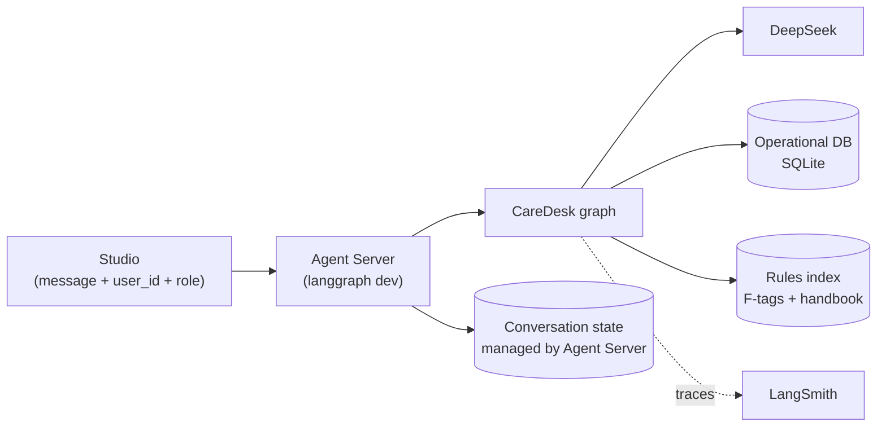
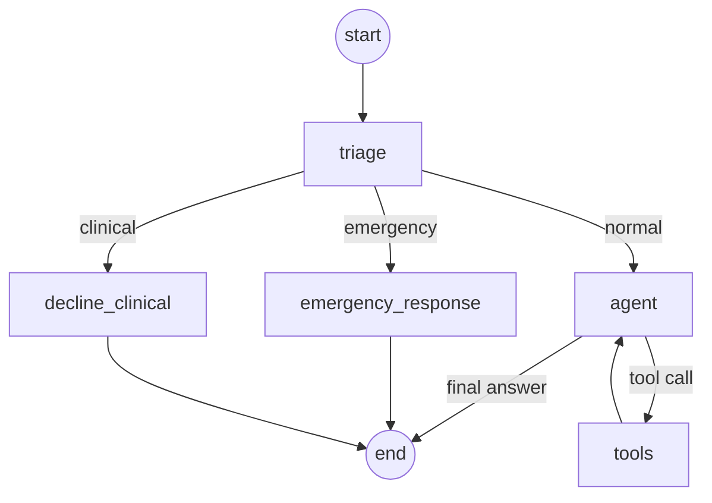

# CareDesk — Architecture

| | |
|---|---|
| Status | Draft |
| Release | 1 |
| Last updated | 2026-10-13 |

How CareDesk is built. What it does is in [prd.md](prd.md); why each choice was made is in [adr/](adr/).

## 1. Overview

Release 1 runs locally: one LangGraph graph on the Agent Server (`langgraph dev`), used through LangGraph Studio. There is no backend API or user app yet.

## 2. Graph

Every message goes through triage first. Only normal questions reach the model.

The graph is built in `build_graph()` in `src/agent/graph.py`.

| Node | What it does | Model? | Code |
|---|---|---|---|
| `triage` | Labels the message `emergency`, `clinical`, or `normal` | Only if no keyword matches | `triage()`; `src/agent/triage.py` |
| `emergency_response` | Records an incident and replies with fixed emergency steps | No | `emergency_response()`; `record_emergency()` |
| `decline_clinical` | Replies with a fixed "please ask the nurse" message | No | `decline_clinical()` |
| `agent` | Answers, or asks for tools | Yes | `agent()` |
| `tools` | Runs the requested tools, then returns to `agent` | No | `ToolNode`; `src/agent/tools.py` |

### Triage

1. **Keyword check.** Obvious emergencies ("not breathing", "fire") go straight to the emergency path, with no model call ([ADR-0016](adr/0016-emergency-keyword-precheck.md)).
2. **Classifier.** Otherwise `deepseek-flash` labels the message. It uses structured output, `with_structured_output(TriageResult, method="json_mode")`, so the reply comes back as a checked object instead of free text and the code reads `result.category` directly. JSON mode, because DeepSeek's thinking mode rejects the default method (a forced tool call).
3. **Fail safe.** Any failure (15-second timeout, bad JSON, unknown label) is treated as an emergency and logged. A false alarm is cheap; a missed emergency is not. An integration test calls the real classifier, so a broken one cannot hide behind this.

### Fixed replies

Emergency and clinical replies are fixed text, not model output, so they cannot go wrong. If the incident cannot be written, the emergency reply is still sent ([ADR-0017](adr/0017-emergency-records-never-block.md)).

### State

| Field | Meaning |
|---|---|
| `messages` | The conversation |
| `route` | Triage result for the latest message |
| `incident_id` | The incident written for an emergency; empty otherwise |

Callers can only send `messages`. The graph sets `route` and `incident_id`, so nobody can skip triage.

### Example

Staff asks "What's on Mary Johnson's schedule today?":

1. `triage`: no keyword, classifier says `normal`
2. `agent`: calls `get_schedule(resident="Mary Johnson", day="today")`
3. `tools`: checks permission, returns today's entries
4. `agent`: writes the answer

## 3. Identity

Each run carries the caller's `user_id` and `role` (`staff` or `family`) in the runtime context. For now they are typed into Studio. Tools read identity from there, never from the chat, so a user cannot change who they are by saying so.

## 4. Tools

All tools are read-only.

| Tool | Reads from |
|---|---|
| `get_my_profile`, `get_resident`, `get_schedule`, `get_activities`, `get_visits`, `get_incidents` (staff only), `get_billing` | Operational DB |
| `search_rules` | Rules index: top 5 passages scoring 0.6 or more, each with its source label |

- Every query applies the caller's permissions before returning rows (`src/agent/records.py`).
- Identity reaches tools through the injected `ToolRuntime`, which the model cannot see or fill in.
- The model only picks a tool and its parameters. It never writes SQL.

## 5. Data

| Store | Holds | Written by |
|---|---|---|
| Operational DB (SQLite) | Residents, family links, staff, schedules, activities, visits, incidents, billing | Seed script with a fixed seed; at runtime, only emergency incidents |
| Rules index (`data/rules_index.json`) | 204 passages from 14 F-tags and the handbook, embedded locally | `scripts/build_rules_index.py` |
| Conversation state | Messages per thread | The Agent Server |

"Today" is fixed at 2026-10-05 (`REFERENCE_DATE` in `src/agent/db`), so answers and evaluations do not change from day to day.

## 6. Models

| Use | Model |
|---|---|
| Triage | `deepseek-flash` |
| Answers | `deepseek-flash`; `deepseek-v4-pro` if evaluation shows it is needed |
| Embeddings | `BAAI/bge-small-en-v1.5`, local through fastembed ([ADR-0015](adr/0015-local-embeddings-in-memory-index.md)) |
| Evaluation judge | Not decided (section 9) |

## 7. Observability

Every run is traced in LangSmith (project `caredesk`) and tagged with `user_id` and `role`, so quality and cost can be split per user and role.

## 8. Evaluation

Evaluations run in LangSmith against the four categories in prd.md section 8, using code-based checks ([ADR-0014](adr/0014-code-based-evaluators.md)). Datasets are in `evals/suites.py`, versioned by name. Each run uses a fresh copy of the database.

| Layer | Checks | Calls an API? |
|---|---|---|
| Unit tests | Permission filters, routing | No |
| Integration tests | The whole graph with a real model | Yes |
| Evaluations | Answers, citations, safety, access control | Yes |

## 9. Open decisions

| Decision | Constraint | Needed by |
|---|---|---|
| Evaluation judge | Must be a different provider from the answering model | First LLM-as-judge evaluation |
