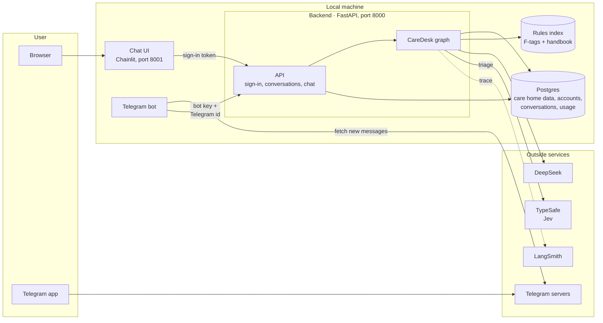
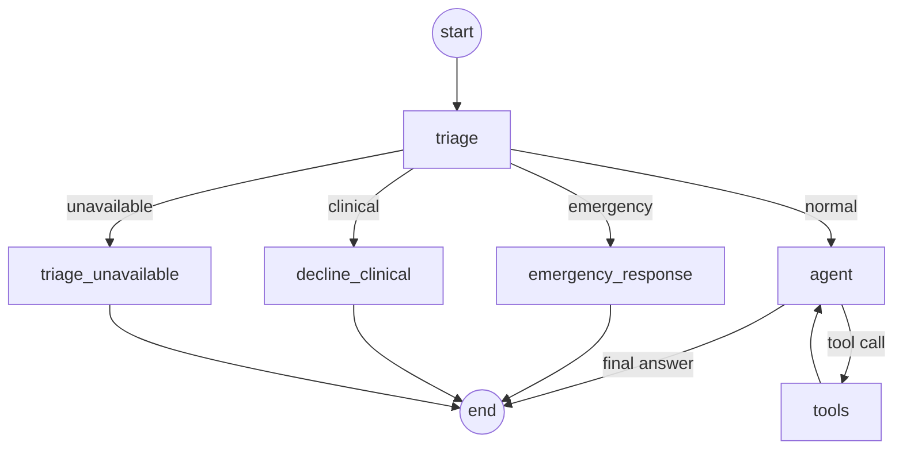

# CareDesk — Architecture

| | |
|---|---|
| Status | Draft |
| Release | 2 (backend and chat UI) |
| Last updated | 2026-10-15 |

How CareDesk is built. What it does is in [prd.md](prd.md); why each choice was made is in [adr/](adr/).

## 1. Overview

Everything runs locally except four outside services: DeepSeek (the model), TypeSafe (Jev, for triage), the Telegram servers, and LangSmith (tracing).

There are two entry points: the Chainlit chat UI in a browser, and the Telegram bot. Both are only clients: they hold no logic or data of their own and just call the backend ([ADR-0024](adr/0024-chainlit-ui-as-backend-client.md), [ADR-0027](adr/0027-telegram-as-a-backend-client.md)). The backend (FastAPI) checks who the user is, then runs the CareDesk graph inside its own process ([ADR-0020](adr/0020-own-backend-not-agent-server.md)). All data lives in one Postgres database in Docker ([ADR-0021](adr/0021-one-postgres-database.md)).

How to read it:

1. The user chats in a browser (Chainlit) or in Telegram. The bot fetches messages from the Telegram servers itself, so it needs no public address.
2. The client forwards the message to the backend API with proof of identity: the sign-in token from Chainlit, or the bot key plus the sender's Telegram id from the bot.
3. The API looks up the account in Postgres, then runs the graph with that account's identity.
4. The graph asks Jev whether the message is an emergency, a clinical question, or normal. For a normal question it reads care home data from Postgres and rules from the index, then calls DeepSeek to write the answer. Conversation history is also stored in Postgres.
5. The answer is streamed back to the client piece by piece. Every run is traced in LangSmith.

For development, the same graph still runs in Studio through `langgraph dev`, with identity typed in by hand.

## 2. Graph

Every message goes through triage first. Only normal questions reach the model.

The graph is built in `build_graph()` in `src/agent/graph.py`.

| Node | What it does | Model? | Code |
|---|---|---|---|
| `triage` | Labels the message `emergency`, `clinical`, or `normal`; `unavailable` if no classifier answers | Jev; DeepSeek if Jev fails | `triage()`; `src/agent/triage.py` |
| `emergency_response` | Replies with fixed emergency steps and contacts; records nothing ([ADR-0030](adr/0030-emergencies-are-not-recorded.md)) | No | `emergency_response()` |
| `decline_clinical` | Replies with a fixed "please ask the nurse" message | No | `decline_clinical()` |
| `triage_unavailable` | Replies with a fixed "could not check your message" text and the emergency contacts | No | `triage_unavailable()` |
| `agent` | Answers, or asks for tools | Yes | `agent()` |
| `tools` | Runs the requested tools, then returns to `agent` | No | `ToolNode`; `src/agent/tools.py` |

### Triage

Every message goes to a classifier; there is no keyword shortcut ([ADR-0029](adr/0029-jev-triage-with-deepseek-fallback.md)).

1. **Jev.** `jev_probabilities()` asks Jev, TypeSafe's decision model, one `choice` question (`JEV_QUESTION`): `emergency`, `clinical`, or `normal`, each described by what it covers and what it is not for. Jev returns a probability for each label. Timeout 3 seconds, no retries; the call is traced in LangSmith as `jev_triage`.
2. **Lean toward emergency.** `jev_route()` picks `emergency` when its probability is 0.3 or more (`EMERGENCY_THRESHOLD`), even if another label scores higher; otherwise the highest label wins. Labels other than the three expected ones count as a failure.
3. **Fallback.** If Jev fails for any reason, `deepseek-flash` labels the message. It uses structured output, `with_structured_output(TriageResult, method="json_mode")`, so the reply comes back as a checked object instead of free text and the code reads `result.category` directly. JSON mode, because DeepSeek's thinking mode rejects the default method (a forced tool call). Timeout 10 seconds, no retries.
4. **Neither answers.** The route is `unavailable` and both failures are logged. The agent does not run.

Integration tests call the real Jev and the real fallback classifier directly, so a broken one cannot hide behind the path after it.

### Fixed replies

Emergency, clinical, and "could not check" replies are fixed text, not model output, so they cannot go wrong. All three carry the emergency contacts, written once in `agent/triage.py`. None of them touches the database.

### State

| Field | Meaning |
|---|---|
| `messages` | The conversation |
| `route` | Triage result for the latest message |
| `triage_by` | Which classifier decided: `jev`, `deepseek`, or empty when neither answered |

Callers can only send `messages`. The graph sets `route` and `triage_by`, so nobody can skip triage.

### Example

Staff asks "What's on Mary Johnson's schedule today?":

1. `triage`: Jev says `normal`, with `emergency` well below 0.3
2. `agent`: calls `get_schedule(resident="Mary Johnson", day="today")`
3. `tools`: checks permission, returns today's entries
4. `agent`: writes the answer

## 3. Identity

Each run carries the caller's `user_id` and `role` (`staff` or `family`) in the runtime context. Tools read identity from there, never from the chat, so a user cannot change who they are by saying so.

In the app, identity comes from sign-in ([ADR-0022](adr/0022-accounts-created-by-the-home.md), [ADR-0023](adr/0023-signed-tokens-for-sign-in.md)):

1. `POST /auth/login` checks email and password against a one-way hash and returns a signed token (8 hours).
2. Every request sends the token. The backend checks it and loads the account from the database.
3. The account's staff or family record becomes `Context(user_id, role)` for the run. The request body cannot change it.

From Telegram, identity comes from a connection made once ([ADR-0027](adr/0027-telegram-as-a-backend-client.md)):

1. A signed-in user asks for a connect link. The backend stores the hash of a random one-time code (10 minutes) for that account.
2. Opening the link sends the code to the bot, which passes it on with the sender's Telegram user id. The backend uses the code up and stores "this Telegram user = this account".
3. From then on the bot calls the backend with its own key and the sender's Telegram user id, which Telegram fills in and the user cannot change. The backend loads the linked account, and step 3 above applies.

In Studio, `user_id` and `role` are still typed in by hand.

## 4. Tools

All tools are read-only.

| Tool | Reads from |
|---|---|
| `get_my_profile`, `get_resident`, `get_schedule`, `get_activities`, `get_visits`, `get_incidents` (staff only), `get_billing` | Postgres, through a read-only connection |
| `search_rules` | Rules index: top 5 passages scoring 0.6 or more, each with its source label |

- Every query applies the caller's permissions before returning rows (`src/agent/records.py`).
- Identity reaches tools through the injected `ToolRuntime`, which the model cannot see or fill in.
- The model only picks a tool and its parameters. It never writes SQL.
- Every connection the agent opens is read-only: Postgres itself rejects any write on it. The agent never writes to the home's records.

## 5. Backend API

Code: `src/backend/` (`main.py` routes, `store.py` queries, `security.py` passwords, tokens, and connect codes, `config.py` settings).

| Endpoint | Does |
|---|---|
| `GET /health` | Server and database are up |
| `POST /auth/login` | Email and password in, token out. Wrong email and wrong password get the same reply |
| `GET /me` | Who is signed in |
| `POST /threads`, `GET /threads` | Start a conversation (optionally with an unused id the client chooses); list your own, titled by their first question |
| `DELETE /threads/{id}` | Delete one of your conversations and its messages; usage rows are kept |
| `GET /threads/{id}/messages` | History of one of your conversations |
| `POST /threads/{id}/messages` | Ask a question; the answer streams back |
| `GET /me/telegram`, `DELETE /me/telegram` | Whether your account is connected to Telegram, and as whom; disconnect |
| `POST /me/telegram/code` | A one-time `t.me` link that connects your Telegram account |
| `GET /texts` | The fixed texts every client shows: what to ask, and the emergency contacts (from `agent/triage.py`, where the numbers are written once) |

Everything except `/health`, `/auth/login`, and `/texts` needs a token. A thread that belongs to someone else gets the same 404 as one that does not exist.

**Bot endpoints** (`/telegram/...`) are for the Telegram bot only and need its key in the `X-Bot-Key` header, never a user token. Without `TELEGRAM_BOT_USERNAME` and `TELEGRAM_BOT_KEY` set, they do not exist (404).

| Endpoint | Does |
|---|---|
| `POST /telegram/connect` | Code and Telegram user id in; connects them and uses the code up. A used, expired, or unknown code gets 400 |
| `POST /telegram/messages` | A connected user's message; the answer streams back exactly as in the web chat |
| `POST /telegram/me` | Who the Telegram user is connected as |
| `POST /telegram/new` | The next message starts a new session |
| `POST /telegram/disconnect` | Disconnects the Telegram user |

A Telegram user who is not connected gets 403 and the agent never runs. Telegram messages continue one session per account (`telegram_links.current_thread_id`), which is an ordinary thread, so it also shows in the web sidebar.

**Chat endpoint.** Check the token, check the thread is yours, run the graph, stream the answer as server-sent events, record usage:

- `token` events carry pieces of the answer. Only the `agent` node's model output is streamed; triage output stays internal. Fixed emergency and clinical replies are sent as one piece.
- A final `done` event carries the triage route, or `error` if something failed.
- One `usage_events` row per request: tokens (from LangChain's usage callback), time taken, route, and channel (`web` or `telegram`). Usage never blocks a request ([ADR-0009](adr/0009-no-hard-usage-limits.md)).

The graph is compiled with LangGraph's Postgres checkpointer, so conversations survive a restart. The checkpointer creates its own tables on startup.

Run it with `uv run uvicorn backend.main:app --env-file .env`.

## 6. Chat UI

Code: `src/ui/` (`app.py` Chainlit handlers, `client.py` backend client, `data_layer.py` sidebar history, `telegram_link.py` Telegram texts and QR code). Run from that folder: `cd src/ui && uv run chainlit run app.py --port 8001`.

| Moment | What happens |
|---|---|
| Sign-in | Chainlit's password form; the backend checks it and returns a token, kept in the Chainlit session for 8 hours |
| Sidebar | The signed-in user's past conversations, listed by the backend with that user's token |
| New chat | A greeting with emergency contacts, both from the backend's `/texts` |
| Message | The backend thread is created on the first message, with Chainlit's thread id; the answer streams in |
| Open a past conversation | Its messages are loaded from the backend and the chat continues in the same thread |
| Delete | Through the backend, which checks ownership |
| Connect Telegram | A button on the greeting, or the `/telegram` command, asks the backend for a one-time link and shows it with a QR code. "Check connection" shows who is connected, with a Disconnect button. These never reach the agent |

The sidebar comes from a Chainlit data layer that stores nothing ([ADR-0025](adr/0025-sidebar-history-from-the-backend.md)). A thread's owner is known only once the backend has returned it with the owner's token; an unknown thread counts as not found, so Chainlit refuses to open it. The backend checks ownership again on every call.

The UI holds no model keys and has its own `.env` with only `BACKEND_URL` and `CHAINLIT_AUTH_SECRET`. It never imports the graph, a model, or the database.

### Telegram bot

Code: `src/telegram_bot/` (`bot.py` Telegram wiring, `relay.py` replies, `streaming.py` drafts while the answer is written, `backend.py` backend client, `format.py` Telegram formatting). Run with `uv run --env-file src/telegram_bot/.env python -m telegram_bot`.

- The bot fetches messages from Telegram (polling), so it runs locally without a public address.
- It answers only in private chats; group messages are ignored, so no group member reads a resident's data.
- Each message goes to the backend with the bot key and the sender's Telegram user id; the backend decides the account (section 3).
- The answer streams in as a Telegram message draft, updated at most once a second, and is then sent as a normal message, which is what stays in the chat ([ADR-0028](adr/0028-telegram-answers-stream-as-drafts.md)). It is converted from Markdown to Telegram's HTML and split under the 4096-character limit; finished parts are sent while the rest is still being written. "typing…" shows until the first words arrive.
- Different users are served side by side, so one slow answer never holds up another user's emergency; each user's own messages are handled in order.
- Users who have not connected get only how to connect and the emergency contacts, both from the backend's `/texts`. If the backend is down, the bot still says to call 911.
- httpx request logging is off, because Telegram's request URLs contain the bot token.

The bot's `.env` holds only `BACKEND_URL`, `TELEGRAM_BOT_TOKEN`, and `TELEGRAM_BOT_KEY`. It never imports the graph, a model, or the database.

## 7. Data

| Store | Holds | Written by |
|---|---|---|
| Postgres: records | Residents, family links, staff, schedules, activities, visits, incidents, billing | Seed script with a fixed seed; never at runtime |
| Postgres: app | Accounts, thread owners and titles, usage events | Seed script (accounts); backend |
| Postgres: checkpoints | Messages per thread | LangGraph's checkpointer |
| Rules index (`data/rules_index.json`) | 204 passages from 14 F-tags and the handbook, embedded locally | `scripts/build_rules_index.py` |

- Schema changes are Alembic migrations in plain SQL (`migrations/versions/`). The seed script drops the schema, migrates it, and fills it, so reseeding also deletes accounts and conversations.
- Postgres runs in Docker (`docker-compose.yml`). `DATABASE_URL` overrides the local default.
- "Today" is fixed at 2026-10-05 (`REFERENCE_DATE` in `src/agent/db`), so answers and evaluations do not change from day to day.

## 8. Models

| Use | Model |
|---|---|
| Triage | Jev (`jev-latest`, TypeSafe); `deepseek-flash` as the fallback ([ADR-0029](adr/0029-jev-triage-with-deepseek-fallback.md)) |
| Answers | `deepseek-flash`; `deepseek-v4-pro` if evaluation shows it is needed |
| Embeddings | `BAAI/bge-small-en-v1.5`, local through fastembed ([ADR-0015](adr/0015-local-embeddings-in-memory-index.md)) |
| Evaluation judge | Not decided (section 11) |

## 9. Observability

Every run is traced in LangSmith (project `caredesk`) and tagged with `user_id` and `role`; runs from the backend also carry `account_id`, `thread_id`, and `channel`. Quality and cost can be split per user and role, and the same tokens are in `usage_events`.

## 10. Evaluation

Evaluations run in LangSmith against the four categories in prd.md section 8, using code-based checks ([ADR-0014](adr/0014-code-based-evaluators.md)). Datasets are in `evals/suites.py`, versioned by name. Each run seeds a throwaway Postgres database and drops it afterwards; unit tests do the same. `evals/compare_triage.py` runs the safety cases through Jev and the fallback classifier directly, several times each, to compare accuracy, consistency, and speed and to check the emergency threshold.

| Layer | Checks | Calls an API? |
|---|---|---|
| Unit tests | Permission filters, routing, the three triage paths, sign-in, thread isolation, streaming, the UI's backend client (fake models) | No |
| Integration tests | The whole graph with a real model; the real Jev and fallback classifier | Yes |
| Evaluations | Answers, citations, safety, access control | Yes |

## 11. Open decisions

| Decision | Constraint | Needed by |
|---|---|---|
| Evaluation judge | Must be a different provider from the answering model | First LLM-as-judge evaluation |
| Rate limiting | Must never block an emergency message (prd.md section 10) | Before the app is reachable by others |
