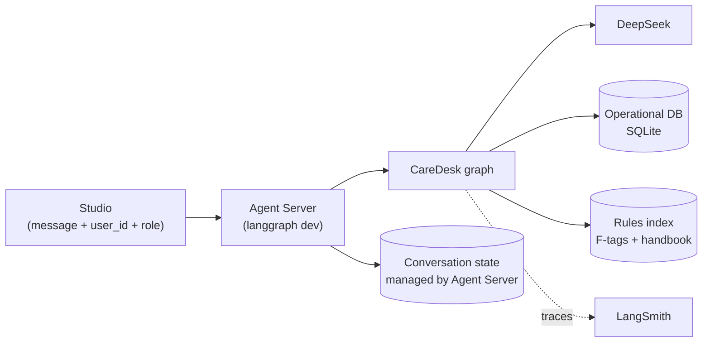
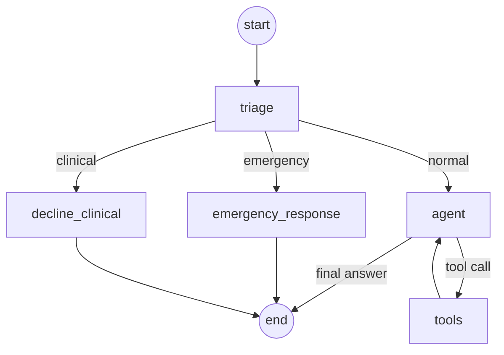

# CareDesk — Architecture

| | |
|---|---|
| Status | Draft |
| Release | 1 |
| Last updated | 2026-10-03 |

What CareDesk does and for whom is in [prd.md](prd.md). This document covers how it is built. The reasons behind each choice are in [adr/](adr/).

## 1. Overview

Release 1 is a single LangGraph graph served by the local Agent Server (`langgraph dev`). LangGraph Studio is the only interface. There is no backend API or end-user UI yet.

## 2. Graph

Every message enters through triage. Only normal questions reach the model loop.

| Node | Job | Uses a model? |
|---|---|---|
| `triage` | Classify the latest message as `emergency`, `clinical`, or `normal` | Yes, `deepseek-flash` with structured output |
| `emergency_response` | Write an incident record, return fixed emergency instructions and contacts | No |
| `decline_clinical` | Return a fixed decline that redirects to nursing staff | No |
| `agent` | Answer normal questions, calling tools when needed | Yes |
| `tools` | Run the tool the model chose | No |

The emergency and clinical paths return fixed text. They do not depend on a model deciding to say the right thing.

**Triage fails toward safety.** If the triage call errors or times out, the message goes down the emergency path. Showing emergency contacts by mistake is cheap; missing an emergency is not.

## 3. Identity

Each run carries the caller's identity in the graph's runtime context:

| Field | Values |
|---|---|
| `user_id` | ID of a staff member or family member in the operational DB |
| `role` | `staff` or `family` |

In release 1 these are typed into Studio by hand. Tools read them from the runtime context, never from the conversation, so a user cannot change who they are by saying so.

## 4. Tools

Two kinds of tools, both read-only:

| Kind | Examples | Source |
|---|---|---|
| Operational | `get_my_profile`, `get_resident`, `get_schedule`, `get_activities`, `get_visits`, `get_incidents` (staff only), `get_billing` | Operational DB, opened read-only |
| Rules | search F-tags and the handbook | Rules index |

Every operational tool applies the caller's permissions (prd.md section 3) inside its own query, before any row is returned (`agent/records.py`). Identity reaches the tools through LangGraph's injected `ToolRuntime`, which is not part of the tool schema, so the model cannot supply it. The model only chooses which tool to call and with which parameters. It never writes a query.

Rules search returns passages with their source (F-tag number or handbook section) so the answer can cite them.

## 5. Data stores

| Store | Holds | Written by |
|---|---|---|
| Operational DB (SQLite file) | Residents, family links and access levels, staff, schedules, activities, visits, incidents, billing | A seed script with a fixed seed. At runtime, only `emergency_response` writes, and only to incidents. |
| Rules index | Chunks of the selected F-tags and the handbook, with embeddings | An ingest script, run once |
| Conversation state | Messages per thread | The Agent Server. No custom checkpointer is configured. |

"Today" inside the data is fixed at 2026-10-05 (`REFERENCE_DATE` in `src/agent/db`). Tools use it instead of the real date, so answers about "today" and evaluation results do not drift from day to day.

## 6. Models

| Use | Model |
|---|---|
| Triage | `deepseek-flash` |
| Agent answers | `deepseek-flash` by default; `deepseek-v4-pro` if evaluation shows flash is not good enough |
| Embeddings | Not decided (section 9) |
| Evaluation judge | Not decided (section 9) |

## 7. Observability

LangSmith tracing is on for every run (project `caredesk`). Each trace carries `user_id` and `role` as metadata, so quality and cost can be broken down per user and per role.

## 8. Evaluation

Evaluation runs in LangSmith against the four categories in prd.md section 8, with code-based checks ([ADR-0014](adr/0014-code-based-evaluators.md)). Datasets live in `evals/suites.py`, are versioned by name, and grow from failures found by reading real outputs. Each run seeds a throwaway database, so evaluations never change `data/caredesk.db`.

Test layers:

| Layer | Checks | Calls an API? |
|---|---|---|
| Unit tests | Tool permission filters, routing logic | No |
| Integration tests | The graph end to end with a real model | Yes |
| Evaluations | Answer quality, citations, safety, access control | Yes |

## 9. Open decisions

| Decision | Options | Needed by |
|---|---|---|
| Embedding model | OpenAI (needs credit) or a local model | Rules search feature |
| Vector store | To be chosen with the embedding model | Rules search feature |
| Evaluation judge | Must be a different provider from the answering model | First LLM-as-judge evaluation |
| Emergency keyword pre-check before triage | Yes or no | Triage feature |

Each becomes an ADR once decided.
