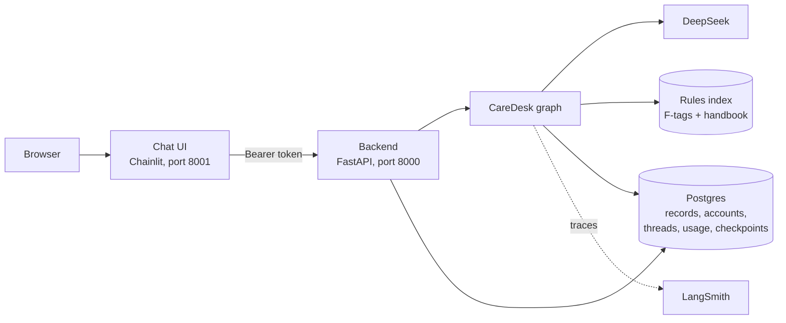
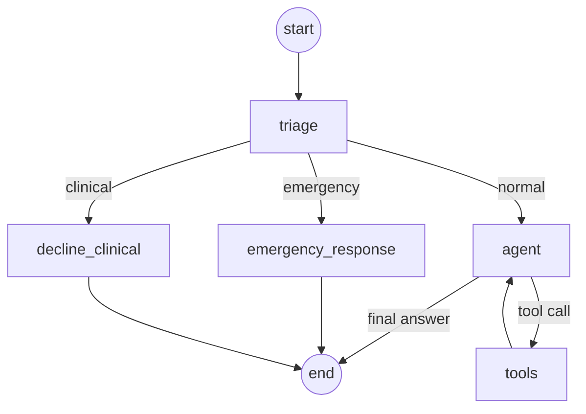

# CareDesk — Architecture

| | |
|---|---|
| Status | Draft |
| Release | 2 (backend and chat UI) |
| Last updated | 2026-10-13 |

How CareDesk is built. What it does is in [prd.md](prd.md); why each choice was made is in [adr/](adr/).

## 1. Overview

Everything runs locally. Users chat in a Chainlit UI, which only calls our backend ([ADR-0024](adr/0024-chainlit-ui-as-backend-client.md)). The backend (FastAPI) signs users in and runs the graph ([ADR-0020](adr/0020-own-backend-not-agent-server.md)). One Postgres database in Docker holds all app data ([ADR-0021](adr/0021-one-postgres-database.md)).

For development, the same graph still runs in Studio through `langgraph dev`, with identity typed in by hand.

## 2. Graph

Every message goes through triage first. Only normal questions reach the model.

The graph is built in `build_graph()` in `src/agent/graph.py`.

| Node | What it does | Model? | Code |
|---|---|---|---|
| `triage` | Labels the message `emergency`, `clinical`, or `normal` | Only if no keyword matches | `triage()`; `src/agent/triage.py` |
| `emergency_response` | Records an incident and replies with fixed emergency steps | No | `emergency_response()`; `record_emergency()` |
| `decline_clinical` | Replies with a fixed "please ask the nurse" message | No | `decline_clinical()` |
| `agent` | Answers, or asks for tools | Yes | `agent()` |
| `tools` | Runs the requested tools, then returns to `agent` | No | `ToolNode`; `src/agent/tools.py` |

### Triage

1. **Keyword check.** Obvious emergencies ("not breathing", "fire") go straight to the emergency path, with no model call ([ADR-0016](adr/0016-emergency-keyword-precheck.md)).
2. **Classifier.** Otherwise `deepseek-flash` labels the message. It uses structured output, `with_structured_output(TriageResult, method="json_mode")`, so the reply comes back as a checked object instead of free text and the code reads `result.category` directly. JSON mode, because DeepSeek's thinking mode rejects the default method (a forced tool call).
3. **Fail safe.** Any failure (15-second timeout, bad JSON, unknown label) is treated as an emergency and logged. A false alarm is cheap; a missed emergency is not. An integration test calls the real classifier, so a broken one cannot hide behind this.

### Fixed replies

Emergency and clinical replies are fixed text, not model output, so they cannot go wrong. If the incident cannot be written, the emergency reply is still sent ([ADR-0017](adr/0017-emergency-records-never-block.md)).

### State

| Field | Meaning |
|---|---|
| `messages` | The conversation |
| `route` | Triage result for the latest message |
| `incident_id` | The incident written for an emergency; empty otherwise |

Callers can only send `messages`. The graph sets `route` and `incident_id`, so nobody can skip triage.

### Example

Staff asks "What's on Mary Johnson's schedule today?":

1. `triage`: no keyword, classifier says `normal`
2. `agent`: calls `get_schedule(resident="Mary Johnson", day="today")`
3. `tools`: checks permission, returns today's entries
4. `agent`: writes the answer

## 3. Identity

Each run carries the caller's `user_id` and `role` (`staff` or `family`) in the runtime context. Tools read identity from there, never from the chat, so a user cannot change who they are by saying so.

In the app, identity comes from sign-in ([ADR-0022](adr/0022-accounts-created-by-the-home.md), [ADR-0023](adr/0023-signed-tokens-for-sign-in.md)):

1. `POST /auth/login` checks email and password against a one-way hash and returns a signed token (8 hours).
2. Every request sends the token. The backend checks it and loads the account from the database.
3. The account's staff or family record becomes `Context(user_id, role)` for the run. The request body cannot change it.

In Studio, `user_id` and `role` are still typed in by hand.

## 4. Tools

All tools are read-only.

| Tool | Reads from |
|---|---|
| `get_my_profile`, `get_resident`, `get_schedule`, `get_activities`, `get_visits`, `get_incidents` (staff only), `get_billing` | Postgres, through a read-only connection |
| `search_rules` | Rules index: top 5 passages scoring 0.6 or more, each with its source label |

- Every query applies the caller's permissions before returning rows (`src/agent/records.py`).
- Identity reaches tools through the injected `ToolRuntime`, which the model cannot see or fill in.
- The model only picks a tool and its parameters. It never writes SQL.
- Tool connections are read-only: Postgres itself rejects any write on them. Only the emergency incident uses a writable connection.

## 5. Backend API

Code: `src/backend/` (`main.py` routes, `store.py` queries, `security.py` passwords and tokens, `config.py` settings).

| Endpoint | Does |
|---|---|
| `GET /health` | Server and database are up |
| `POST /auth/login` | Email and password in, token out. Wrong email and wrong password get the same reply |
| `GET /me` | Who is signed in |
| `POST /threads`, `GET /threads` | Start a conversation (optionally with an unused id the client chooses); list your own, titled by their first question |
| `DELETE /threads/{id}` | Delete one of your conversations and its messages; usage rows are kept |
| `GET /threads/{id}/messages` | History of one of your conversations |
| `POST /threads/{id}/messages` | Ask a question; the answer streams back |

Everything except `/health` and `/auth/login` needs a token. A thread that belongs to someone else gets the same 404 as one that does not exist.

**Chat endpoint.** Check the token, check the thread is yours, run the graph, stream the answer as server-sent events, record usage:

- `token` events carry pieces of the answer. Only the `agent` node's model output is streamed; triage output stays internal. Fixed emergency and clinical replies are sent as one piece.
- A final `done` event carries the triage route, or `error` if something failed.
- One `usage_events` row per request: tokens (from LangChain's usage callback), time taken, route. Usage never blocks a request ([ADR-0009](adr/0009-no-hard-usage-limits.md)).

The graph is compiled with LangGraph's Postgres checkpointer, so conversations survive a restart. The checkpointer creates its own tables on startup.

Run it with `uv run uvicorn backend.main:app --env-file .env`.

## 6. Chat UI

Code: `src/ui/` (`app.py` Chainlit handlers, `client.py` backend client, `data_layer.py` sidebar history). Run from that folder: `cd src/ui && uv run chainlit run app.py --port 8001`.

| Moment | What happens |
|---|---|
| Sign-in | Chainlit's password form; the backend checks it and returns a token, kept in the Chainlit session for 8 hours |
| Sidebar | The signed-in user's past conversations, listed by the backend with that user's token |
| New chat | A greeting with emergency contacts |
| Message | The backend thread is created on the first message, with Chainlit's thread id; the answer streams in |
| Open a past conversation | Its messages are loaded from the backend and the chat continues in the same thread |
| Delete | Through the backend, which checks ownership |

The sidebar comes from a Chainlit data layer that stores nothing ([ADR-0025](adr/0025-sidebar-history-from-the-backend.md)). A thread's owner is known only once the backend has returned it with the owner's token; an unknown thread counts as not found, so Chainlit refuses to open it. The backend checks ownership again on every call.

The UI holds no model keys and has its own `.env` with only `BACKEND_URL` and `CHAINLIT_AUTH_SECRET`. It never imports the graph, a model, or the database.

## 7. Data

| Store | Holds | Written by |
|---|---|---|
| Postgres: records | Residents, family links, staff, schedules, activities, visits, incidents, billing | Seed script with a fixed seed; at runtime, only emergency incidents |
| Postgres: app | Accounts, thread owners and titles, usage events | Seed script (accounts); backend |
| Postgres: checkpoints | Messages per thread | LangGraph's checkpointer |
| Rules index (`data/rules_index.json`) | 204 passages from 14 F-tags and the handbook, embedded locally | `scripts/build_rules_index.py` |

- Schema changes are Alembic migrations in plain SQL (`migrations/versions/`). The seed script drops the schema, migrates it, and fills it, so reseeding also deletes accounts and conversations.
- Postgres runs in Docker (`docker-compose.yml`). `DATABASE_URL` overrides the local default.
- "Today" is fixed at 2026-10-05 (`REFERENCE_DATE` in `src/agent/db`), so answers and evaluations do not change from day to day.

## 8. Models

| Use | Model |
|---|---|
| Triage | `deepseek-flash` |
| Answers | `deepseek-flash`; `deepseek-v4-pro` if evaluation shows it is needed |
| Embeddings | `BAAI/bge-small-en-v1.5`, local through fastembed ([ADR-0015](adr/0015-local-embeddings-in-memory-index.md)) |
| Evaluation judge | Not decided (section 11) |

## 9. Observability

Every run is traced in LangSmith (project `caredesk`) and tagged with `user_id` and `role`; runs from the backend also carry `account_id` and `thread_id`. Quality and cost can be split per user and role, and the same tokens are in `usage_events`.

## 10. Evaluation

Evaluations run in LangSmith against the four categories in prd.md section 8, using code-based checks ([ADR-0014](adr/0014-code-based-evaluators.md)). Datasets are in `evals/suites.py`, versioned by name. Each run seeds a throwaway Postgres database and drops it afterwards; unit tests do the same.

| Layer | Checks | Calls an API? |
|---|---|---|
| Unit tests | Permission filters, routing, sign-in, thread isolation, streaming, the UI's backend client (fake models) | No |
| Integration tests | The whole graph with a real model | Yes |
| Evaluations | Answers, citations, safety, access control | Yes |

## 11. Open decisions

| Decision | Constraint | Needed by |
|---|---|---|
| Evaluation judge | Must be a different provider from the answering model | First LLM-as-judge evaluation |
| Rate limiting | Must never block an emergency message (prd.md section 10) | Before the app is reachable by others |
